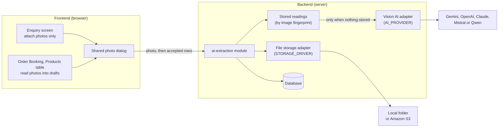
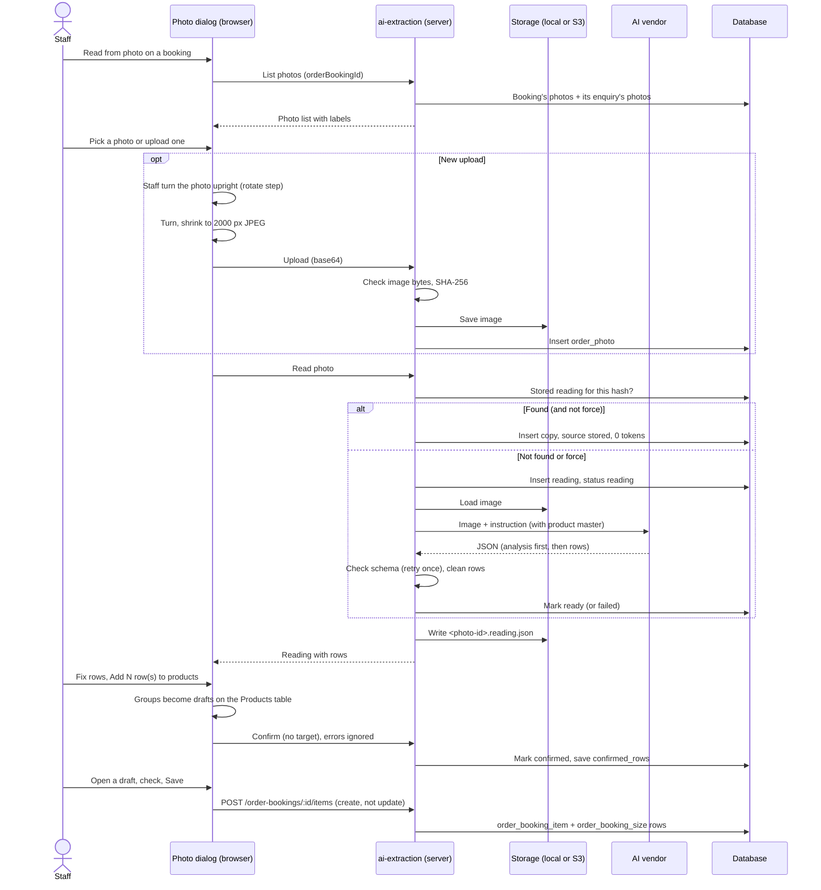

# AI Photo Reading Developer Guide: Required Fields & Implementation

> **Target Audience:** Developers and AI Agents.
> **Purpose:** A full reference for the AI photo reading feature in toughened-glass: the data it stores and where, the rules it enforces, how the server and screens are built, what is still to do, and how to test it. Everything here was checked against the `dev` branch of `rubine-toughened-glass-backend` and `rubine-toughened-glass-frontend` on 2026-10-07. Where the code differs from the original plan in `toughened-glass/ai-extraction-plans/`, the code wins and the difference is listed in section 8.

---

## 1. Required Fields & Originating Modules

The feature works across four places: **the photo** (an uploaded image), **the reading** (what the AI made of it), **the rows** (one per kind of glass piece), and **the order booking size rows** the rows finally turn into. Two server settings (`AI_PROVIDER` and `STORAGE_DRIVER`) decide everything that is not decided yet.

### 1.1 The Photo (`public.order_photo`)
*Created when staff upload a photo on the Enquiry screen (Photos button) or on Order Booking (Read from photo). Table defined in `src/database/migrations/001_multi_tenant_schema.sql`, changed by `044_pk_phase7_enquiry.sql` and `045_pk_phase8_order_booking.sql`.*

| Field | Required | Where to Fill in App | Database Column | Notes |
|---|---|---|---|---|
| **Id** | Yes | Auto | `order_photo.id` | UUID made by the server. Also the file name in storage. |
| **Company** | Yes | Auto (logged in user) | `order_photo.company_id` | Every query filters by it. Cascades on company delete (`031_cascade_delete_company.sql`). |
| **Screen** | Yes | Auto (which screen uploaded it) | `order_photo.screen` | `enquiry` or `order_booking` (check constraint). |
| **Record** | Optional | Auto | `order_photo.record_id` | `VARCHAR(50)`. Holds the **business code**, not a UUID: `enquiry_code` for an enquiry, `order_code` for a booking. Empty means the photo was attached before its record was saved. No foreign key, because it points at a different table per screen. |
| **Storage driver** | Yes | Auto (`STORAGE_DRIVER` at upload time) | `order_photo.storage_driver` | `local` or `s3`. Each photo is always read back from the storage it was saved in. |
| **Storage key** | Yes | Auto | `order_photo.storage_key` | For example `order-photos/2026/09/<photo-id>.jpg`. Made by the server, never taken from user input. |
| **Reading key** | Optional | Auto (after the first read) | `order_photo.reading_key` | Where the reading JSON sits next to the image: `<photo-id>.reading.json`. |
| **Fingerprint** | Yes | Auto | `order_photo.content_hash` | SHA-256 of the exact image bytes, `CHAR(64)`, indexed. This is how a reading is reused. |
| **Type** | Yes | File picker / camera | `order_photo.mime_type` | `image/jpeg`, `image/png` or `image/webp`. The browser always sends JPEG after turning and shrinking. |
| **Size** | Yes | Auto | `order_photo.size_bytes` | Bytes after turning and shrinking. |
| **Original name** | Optional | File picker | `order_photo.original_name` | Up to 255 characters. Shown in the photo list. |
| **Uploaded by / at** | Yes | Auto | `order_photo.uploaded_by`, `uploaded_at` | `uploaded_by` points at `core.app_user`. |

**The orientation is part of the file.** Before a photo is uploaded, staff turn it upright in a rotate step (section 6.2). The turn is drawn into the pixels, so the stored image, its `content_hash` and every reading of it share one orientation for the life of the image. Nothing about the turn is stored in a column. The same sheet uploaded in another orientation is a different image with a different hash, so it is read and paid for again. This is on purpose: the AI is told to treat the photo exactly as it receives it.

Indexes: `(screen, record_id)`, `(content_hash)`, `(company_id)`.

---

### 1.2 The Reading (`public.order_photo_reading`)
*Created every time a photo is read on Order Booking. One photo can have many readings.*

| Field | Required | Where to Fill in App | Database Column | Notes |
|---|---|---|---|---|
| **Photo** | Yes | Auto | `order_photo_reading.photo_id` | Foreign key to `order_photo`. |
| **Source** | Yes | Auto | `order_photo_reading.source` | `ai` (paid vendor call) or `stored` (copied from an earlier reading of the same image, free). |
| **Reused from** | Optional | Auto | `order_photo_reading.reused_from_id` | For `stored` readings, the reading it was copied from. |
| **Provider / Model** | Yes | Auto (`AI_PROVIDER`, `AI_MODEL`) | `provider`, `model` | Which vendor and model read it. Kept to compare vendors. |
| **Status** | Yes | Auto | `order_photo_reading.status` | `reading` (in progress), `ready`, `failed`, `confirmed`. |
| **Rows** | Optional | Auto (from the AI) | `order_photo_reading.rows` | JSONB array of cleaned rows (section 1.3). |
| **Confirmed rows** | Optional | Review panel (Add rows to products) | `order_photo_reading.confirmed_rows` | What staff accepted, after their fixes. Compared with `rows` to measure accuracy. |
| **Sheet total** | Optional | Auto (from the AI) | `order_photo_reading.sheet_total` | The total written on the sheet, else the AI's own count, else null. |
| **Product name** | Optional | Auto (from the AI) | `order_photo_reading.product_name` | The glass named on the sheet for the whole order, for example "12mm Clear Toughened". Up to 200 characters. |
| **Tokens** | Optional | Auto | `input_tokens`, `output_tokens` | Real usage, for real cost per photo. Zero for `stored`. Gemini thinking tokens are counted as output. If the reply had to be retried, both tries are added up. |
| **Duration** | Optional | Auto | `order_photo_reading.duration_ms` | How long the vendor took. Zero for `stored`. |
| **Error** | Optional | Auto | `order_photo_reading.error_message` | The vendor's error, up to 1000 characters, when status is `failed`. |
| **Created / Confirmed by and at** | Yes / Optional | Auto | `created_by`, `created_at`, `confirmed_by`, `confirmed_at` | Users point at `core.app_user`. |

Indexes: `(photo_id, created_at DESC)`, `(company_id)`.

---

### 1.3 One Row Read From a Photo (inside `rows` / `confirmed_rows`)
*Built by `row-cleanup.ts` from the AI's reply, edited by staff in the review panel, then turned into a size row by the Add Product form (`sizeFromReadingRow` in `features/order-booking/add-product-modal.tsx`).*

| Field | Required | Where to Fill in App | Ends up in | Notes |
|---|---|---|---|---|
| **code** | Optional | Review panel | `order_booking_size.glass_size_code` | W1, W16 and so on. Cut to 50 characters on the server path. |
| **topWidthMm** | Yes | Review panel (Top W) | Top Width | The top edge, as the photo is held. Always mm. Inches are converted with 25.4 and rounded to a whole mm. Must be above 0. |
| **bottomWidthMm** | Yes | Review panel (Bottom W) | Bottom Width | The bottom edge. Same rules. A plain rectangle has this equal to the top width. |
| **leftLengthMm** | Yes | Review panel (Left L) | Left Length | The left edge, as the photo is held. Same rules. |
| **rightLengthMm** | Yes | Review panel (Right L) | Right Length | The right edge. Same rules. A plain rectangle has this equal to the left length. |
| **quantity** | Yes | Review panel | Qty | Whole number above 0. The cleanup rounds and forces at least 1. |
| **glassType** | Optional | Review panel | Size row Remark | Normalised: "tuff", "tufft", "tgh" become "toughened", "frost" becomes "frosted", "clr" becomes "clear"; thickness is cut out of the text. |
| **thicknessMm** | Optional | Review panel | Size row Remark, and the draft product's thickness when all rows agree | Taken from the text ("12mm") if the AI left it empty. Over 30 mm is dropped and flagged. |
| **edgeWork** | Optional | Review panel | Size row Remark | |
| **note** | Optional | Review panel (Remarks line) | Size row Remark | Hole sizes and positions, "fixed" or "door", how a size was derived. |
| **holeQty** | Optional | Review panel | Hole Qty | Per single piece. If the AI wrote it only in words ("2 holes", "4 nos hole"), the count is recovered from the note or edge work. |
| **centreHoleQty** | Optional | Review panel | Centre Hole Qty | Only when the sheet says "centre hole" or "CH". Read first and cut out of the text so it is not also counted as a normal hole. |
| **cutoutQty** | Optional | Review panel | Cutout Qty | Also recovered from words like "cut out", "notch", "c/o". |
| **unsureFields** | Yes (can be empty) | Auto | Not saved on the size row | Field names the AI was unsure about. Shown yellow. Editing a field removes it from the list. |
| **originalSize** | Optional | Auto | Size row Remark ("from 53.5 x 25.5 in") | Only set when the sheet was in inches. When opposite sides differ it reads "T 53.5 / B 54 x L 25.5 / R 25.5 in". |
| **originalSides** | Optional | Auto | Not saved on the size row | The four sides as written on the sheet, in inches (`top`, `bottom`, `left`, `right`). Only set when the sheet was in inches. The review panel shows each one under its own field, for example "36.25 in". Missing on readings saved before this was added. |

The size row Remark is built as: `<thickness>mm <glassType> | <edgeWork> | <note> | from <originalSize>`, skipping empty parts.

**Overall size.** The Size Details tab and the server both treat the overall size as the larger of each pair: Actual Width is the larger of top and bottom, Actual Length is the larger of left and right. `sizeFromReadingRow` does this in the browser and `toOrderBookingSize` in `ai-extraction.service.ts` does it on the server path.

**Older readings.** A reading saved before the four side change holds one `widthMm` and one `heightMm`. `normalizeStoredRow()` in `row-cleanup.ts` converts it when it is read from the database: top and bottom get the old width, left and right get the old height. No data migration is needed. These readings have no `originalSides`.

**Null is not zero.** Null means the sheet said nothing and the field stays blank. Zero means the sheet said there are none.

**Big Hole, Big Centre Hole and Big Cutout are always left empty.** Whether a hole is "big" is a factory rule about diameter, not something on the sheet.

---

### 1.4 Server Settings (`rubine-toughened-glass-backend/.env`, checked in `src/config/env.ts`)
*Full setup steps are in [AI_EXTRACTION_SETUP.md](AI_EXTRACTION_SETUP.md).*

| Field | Required | Where to Fill in App | Setting | Notes |
|---|---|---|---|---|
| **AI vendor** | No (empty = reading off) | Backend `.env` / Vercel | `AI_PROVIDER` | `gemini`, `openai`, `anthropic`, `mistral` or `qwen`. |
| **Model** | When `AI_PROVIDER` is set | Backend `.env` | `AI_MODEL` | Exact model name at that vendor. |
| **Vendor key** | Only the chosen vendor's | Backend `.env` | `GEMINI_API_KEY`, `OPENAI_API_KEY`, `ANTHROPIC_API_KEY`, `MISTRAL_API_KEY`, `QWEN_API_KEY` | The server refuses to start if the chosen vendor's key or `AI_MODEL` is missing. |
| **Timeout** | No | Backend `.env` | `AI_TIMEOUT_MS` | Default `60000`. |
| **Gemini thinking** | No | Backend `.env` | `GEMINI_THINKING_LEVEL` | `minimal`, `low`, `medium`, `high`. No default in code; `.env.example` ships `high`. Leave empty for Gemini 2.5 and older. |
| **Qwen address** | No | Backend `.env` | `QWEN_BASE_URL` | Default is the Singapore endpoint. |
| **Storage** | No | Backend `.env` | `STORAGE_DRIVER`, `LOCAL_STORAGE_DIR` | Defaults `local` and `uploads`. |
| **S3** | When `STORAGE_DRIVER=s3` | Backend `.env` | `S3_BUCKET`, `S3_REGION`, `S3_ACCESS_KEY_ID`, `S3_SECRET_ACCESS_KEY`, `S3_ENDPOINT` | `S3_ENDPOINT` only for R2 or MinIO. |
| **Limits** | No | Backend `.env` | `PHOTO_MAX_MB`, `PHOTO_READS_PER_MINUTE` | Defaults `6` and `10`. |

The frontend needs nothing new (only `VITE_API_URL`). **Never put an AI key in the frontend.**

---

## 2. Eligibility & Validation Rules Checklist

Before and during a read, the system checks:

1. **Logged in and allowed:** every `/ai-extraction` route needs a logged in user (`requireAuth`) and a right on the `ai_extraction` module: `VIEW` to list, view files and readings, and see settings; `ADD` to upload and to confirm; `READ` to read with AI.
2. **Upload is a real image:** the type must be JPEG, PNG or WEBP, and the first bytes of the file must really match that type. Plain base64 and `data:` URLs are both accepted.
3. **Upload size:** the photo upload route alone accepts up to `PHOTO_MAX_MB` (6 MB). Every other route stays at 2 MB. Vercel itself refuses anything over about 4.5 MB, which is why the browser shrinks photos first.
4. **The record exists:** when an upload names a record, an enquiry with that `enquiry_code` or a booking with that `order_code` must exist in the same company, otherwise 404 `ORDER_PHOTO_RECORD_NOT_FOUND`.
5. **No orphan files:** if saving the photo row fails after the file was written, the file is deleted again.
6. **Listing:** pass either `screen` (+ optional `recordId`) or `orderBookingId`, never both. Lists return at most 50 photos, newest first.
7. **Reading is switched on:** if `AI_PROVIDER` or `AI_MODEL` is missing, a read fails with 400 `AI_NOT_CONFIGURED` before anything is saved.
8. **Read rate limit:** at most `PHOTO_READS_PER_MINUTE` (10) reads per user per minute (`photoReadRateLimiter`), on top of the global limit of 300 requests per 15 minutes per IP.
9. **Reuse before paying:** unless `force=true`, a read first looks for the newest `ready` or `confirmed` reading of **another** photo with the same `content_hash` that has rows. If found, it is copied (for a `confirmed` one, its `confirmed_rows` are copied). No vendor call.
10. **The reply must match the schema:** the vendor's JSON is checked with Zod (`result.schema.ts`). If it does not match, the vendor is asked once more. A second failure saves the reading as `failed`. A vendor error never throws to the screen; it becomes a `failed` reading with the message.
11. **Confirming:** at least 1 and at most 200 rows; each row needs all four sides and quantity above 0. The reading must be `ready` (409 `ORDER_PHOTO_READING_NOT_READY` otherwise). The reading is claimed first (`ready` to `confirmed` in one update), so a double click cannot confirm twice. A target is all or nothing: `orderBookingId` and `itemId` together or neither (400 `ORDER_PHOTO_NO_TARGET`). If writing the rows to a target fails, the reading is put back to `ready`.
12. **Review panel:** **Add N row(s) to products** stays off until a reading is open, at least one row is ticked, and every ticked row has all four sides and quantity above 0.
13. **Booking save gate:** Save, Order Preview and Submit are off while there are no products, or while any draft read from a photo has not been reviewed and saved. The reasons are listed in red under the table.
14. **Enquiry upload lock:** on the Enquiry screen, upload and camera are disabled unless the enquiry status is `OPEN`.
15. **Booking lock:** when the booking is no longer `DRAFT`, the Products toolbar (including Read from photo) is replaced by a "products can no longer be added or edited" note.
16. **Turn before upload:** choosing or taking a photo (Enquiry or Order Booking) opens a rotate step first. Nothing is uploaded until staff click **Use this photo**. **Choose another** drops the photo without uploading.

---

## 3. Implementation Guide (pending steps)

The feature is built with two adapter patterns: one shared shape for every AI vendor, picked by `AI_PROVIDER`, and one shared shape for every file store, picked by `STORAGE_DRIVER`. The screens and the `ai-extraction` module are complete. What is left is configuration and one cleanup job.

```text
┌─────────────────────────────────────────────────────┐
│     Frontend: Enquiry Photos + Read from photo      │
│          (NO CHANGES NEEDED - COMPLETE)             │
└─────────────────────┬───────────────────────────────┘
                      │
                      ▼
┌─────────────────────────────────────────────────────┐
│   Backend: ai-extraction module, reuse by hash      │
│          (NO CHANGES NEEDED - COMPLETE)             │
└─────────────────────┬───────────────────────────────┘
                      │
                      ▼
┌─────────────────────────────────────────────────────┐
│  1. .env / Vercel (EDIT: AI_PROVIDER, AI_MODEL, key)│
└──────────────┬──────────────────────────────────────┘
               │
               ▼
┌─────────────────────────────────────────────────────┐
│  2. .env / Vercel (EDIT: STORAGE_DRIVER=s3 + S3_*)  │
└──────────────┬──────────────────────────────────────┘
               │
               ▼
┌─────────────────────────────────────────────────────┐
│  3. New cleanup cron job (CREATE, after the client  │
│     agrees how long photos are kept)                │
└─────────────────────────────────────────────────────┘
```

---

### Step 1: Switch reading on with the chosen vendor
Edit `rubine-toughened-glass-backend/.env` (and Vercel's Environment Variables for the live server), then restart:

```bash
AI_PROVIDER=gemini            # gemini | openai | anthropic | mistral | qwen
AI_MODEL=gemini-3.8-flash     # exact model name at that vendor
GEMINI_API_KEY=<key>          # only the chosen vendor's key is needed
GEMINI_THINKING_LEVEL=high    # Gemini only, optional
```

No code change. Check the Vercel function time limit is longer than `AI_TIMEOUT_MS` (60 seconds).

---

### Step 2: Move photos to S3 before going live on Vercel
Vercel has no disk that survives, so `local` is only for development or a normal server with a disk.

```bash
STORAGE_DRIVER=s3
S3_BUCKET=rubine-order-photos
S3_REGION=ap-south-1
S3_ACCESS_KEY_ID=<key id>
S3_SECRET_ACCESS_KEY=<secret>
S3_ENDPOINT=                  # only for Cloudflare R2 or MinIO
```

Old local photos keep opening after the switch, because each photo remembers its own `storage_driver`. To move them: copy `uploads/order-photos` into the bucket under `order-photos/`, then set `storage_driver = 's3'` on those rows in `order_photo`.

---

### Step 3: Write the housekeeping cron job (not started)
Nothing is ever deleted today, so `order_photo` rows, `order_photo_reading` rows, and image and `.reading.json` files grow forever. At about 50 photos a day that is about 18,000 photos and 5 GB a year (around 300 KB per shrunk photo). Not urgent, but not something to leave forever.

**Agree the retention rule with the client first.** These are customer documents and may be needed months later in a dispute. Do not guess a number.

What the job must do once the rule is agreed:

1. Find photos that are no longer wanted. Likely candidates: photos never confirmed onto an order and older than some number of months, and photos whose enquiry or booking was cancelled.
2. Delete in this order: readings, then photo rows, then files in storage. A half finished run must never leave a row pointing at a missing file. Note that `order_photo_reading.reused_from_id` points at other readings, so a reading that others were copied from must be handled (clear the link or delete the copies first).
3. Log what it removed, so the first runs can be checked.

Reminders are in the code: the "THIS IS NOT A CACHE" comment at the top of the Readings section of `src/modules/ai-extraction/ai-extraction.service.ts`.

---

### Step 4 (only if needed): Add another AI vendor
1. Add one file in `src/shared/vision-ai/providers/` that implements `VisionAiProvider` (`name`, `model`, `readRaw(photo, instruction)` returning `{ text, inputTokens, outputTokens }`).
2. Add its name to `AI_PROVIDERS` and its key to `PROVIDER_KEY` in `src/config/env.ts`.
3. Add one `case` to `getVisionAiProvider()` in `src/shared/vision-ai/vision-ai.factory.ts`.

Parsing, the shared schema check, the single retry and token adding all live in `readOrderSheet()`, so the new file only has to call the vendor.

---

## 4. What Already Works (Zero Changes Needed)

1. **Attaching photos on Enquiry:** Photos button per enquiry row, upload or camera, view full size, no AI. The enquiry list also returns the photo count.
2. **Photos travel from enquiry to booking:** a booking made from an enquiry lists the enquiry's photos labelled "From enquiry".
3. **Turning and shrinking in the browser:** staff turn the photo upright in a rotate step (Rotate left and Rotate right, with a preview). Then it is turned, shrunk to at most 2000 px on the long side and saved as JPEG at quality 0.85, with the phone's own EXIF rotation applied first and a white background for transparent PNGs. This keeps uploads small and makes two uploads of one picture in the same orientation byte for byte the same, so reuse works.
4. **Reuse by fingerprint:** the same image is never paid for twice, across users and screens. The panel shows a green note when a reading was reused.
5. **Reading JSON next to the image:** written after every read (`<photo-id>.reading.json`) so readings survive outside the database. A storage failure here only logs a warning; it never fails the read.
6. **Five vendors ready:** Gemini, OpenAI, Anthropic, Mistral, Qwen, each with JSON output (forced schema for Gemini, OpenAI and Anthropic; plain JSON mode for Mistral and Qwen, still checked by the shared schema).
7. **Product master in the instruction:** active products and their active sub products, held in memory for 10 minutes, so new products reach the next readings without a restart. If the query fails, the last list (or none) is used and the read still goes ahead.
8. **Review panel:** grouped by glass, editable group names, unsure values in yellow, remarks line under each row, sticky header, total check, Read again, zoom.
9. **Drafts and merge:** one draft per glass on the Products table, safe to fill again, already saved glass skipped (section 6.4).
10. **Product match and notes:** green or amber note under Product Details, ties never guessed, never overwrites a chosen product.
11. **Rate filled in:** the master rate is put onto every draft size row as soon as the product is known.
12. **Save gate:** booking cannot be saved, previewed or submitted with unreviewed drafts.
13. **Photo download cache:** each photo file is downloaded once and reused (up to 60 kept, 3 downloads at a time), thumbnails load only when scrolled into view, and photo lists stay fresh for 60 seconds, so the server's rate limit is not used up.
14. **Products table photo column:** saved products show a Photos badge with the order's photos (view only) and "Saved" when the product came from a reviewed draft.
15. **Recents on the Read from photo window:** on an order booking the list under the upload boxes is titled "Recents" and shows one row of the 3 newest photos. **See more**, at the right end of the title row, opens a "Photos for this order" window with every photo the order can use. The Enquiry window keeps its full list.
16. **Photo pane fits and scrolls:** in the Read from photo window on wide screens the photo and the rows share one fixed height (70% of the window). The photo always fits inside its pane, and zoom scrolls both ways. On narrow screens the two parts stack. The rows table has a minimum width and scrolls sideways inside its own box.

---

## 5. Code Map

### 5.1 Backend (`rubine-toughened-glass-backend`)

```
src/
├── modules/ai-extraction/
│   ├── ai-extraction.routes.ts      routes, auth, rights, read rate limit
│   ├── ai-extraction.controller.ts
│   ├── ai-extraction.service.ts     upload, list, read (reuse first), confirm, settings
│   ├── ai-extraction.repository.ts  SQL for order_photo and order_photo_reading
│   ├── ai-extraction.schema.ts      Zod checks for requests
│   ├── ai-extraction.types.ts       row and reading shapes
│   ├── product-vocabulary.ts        product master for the instruction, held 10 min
│   └── row-cleanup.ts               inches to mm, glass words, thickness, hole counts from text
├── shared/vision-ai/
│   ├── vision-ai.types.ts           the shape every vendor follows
│   ├── vision-ai.factory.ts         picks the vendor; readOrderSheet() parses, checks, retries once
│   ├── instruction.ts               buildOrderSheetInstruction(vocabulary?)
│   ├── result.schema.ts             Zod schema + the same shape as JSON Schema
│   └── providers/                   gemini, openai, anthropic, mistral, qwen (qwen reuses openai)
├── shared/storage/
│   ├── storage.types.ts             save / read / remove
│   ├── storage.factory.ts           picks local or s3; getStorage(driver?)
│   ├── local.storage.ts             LOCAL_STORAGE_DIR, refuses keys that escape the folder
│   └── s3.storage.ts                private bucket, path style when S3_ENDPOINT is set
├── modules/order-booking/           POST /:id/items/:itemId/sizes/bulk (all or nothing)
├── modules/enquiry/                 enquiry list includes photo_count
├── middlewares/rate-limit.middleware.ts   photoReadRateLimiter (per user, per minute)
├── app.ts                           bigger JSON limit only on the upload route
└── config/env.ts                    all settings and their rules
uploads/                             local photos and reading JSON (gitignored)
```

Packages: `@google/genai`, `openai` (also used for Qwen), `@anthropic-ai/sdk`, `@mistralai/mistralai`, `@aws-sdk/client-s3`. All are installed so switching vendor is a settings change only.

Rights are seeded in `src/database/seeds/010_rbac_seed_data.sql` (module `ai_extraction`, label "AI Vision Extraction").

### 5.2 Frontend (`rubine-toughened-glass-frontend`)

```
src/features/ai-extraction/
├── read-from-photo-button.tsx   "Read from photo" on the Products toolbar (mode extract)
├── enquiry-photos-button.tsx    "Photos" on each enquiry row (mode attach)
├── photo-review-panel.tsx       the shared dialog: picker, photo, rows, apply
├── group-rows.ts                one group per glass description
├── photo-thumb.tsx              thumbnail, loads only when on screen
├── shrink-photo.ts              turn (0/90/180/270), preview, 2000 px JPEG in the browser
├── api.ts                       API calls + the photo download cache
├── queries.ts                   React Query options
└── types.ts

src/features/order-booking/
├── products-tab.tsx             holds drafts, "Read from photo" column, save blockers
├── draft-products.ts            DraftProduct + mergeGroupsIntoDrafts()
├── product-match.ts             matchProductName(): matched / unknown / none
├── product-detail-panel.tsx     green or amber note
├── add-product-modal.tsx        takes a draft; sizeFromReadingRow(); rate fill
├── booking-photo-cell.tsx       Photos badge on saved product rows (view only)
└── schema.ts                    EMPTY_SIZE_DEFAULTS (blank size row shape)

src/features/enquiries/enquiries-page.tsx   Photos button per row, locked unless OPEN
```

The dialog has two modes:

- `attach` (Enquiry): upload, list and view only. No read button, no rows, nothing sent to the AI.
- `extract` (Products table): the full flow. It **never writes to the order**. It hands groups to the caller through `onApplyGroups(groups, reading)`.

Images cannot use a plain `` because the file route needs the login cookie, so files are fetched and shown as object URLs. Photos are sent as base64 JSON because `api-client.ts` only sends JSON.

### 5.3 Routes (all under `/api/v1`, all need login)

| Method | Route | Right | What it does |
|---|---|---|---|
| GET | `/ai-extraction/settings` | VIEW | `readingEnabled`, provider, model, storage driver, max MB, `saveAvailableOn: ["order_booking"]` |
| POST | `/ai-extraction/photos` | ADD | Upload `{ screen, recordId?, mimeType, imageBase64, fileName? }` |
| GET | `/ai-extraction/photos?screen=&recordId=` | VIEW | Photos on one enquiry or booking |
| GET | `/ai-extraction/photos?orderBookingId=<order_code>` | VIEW | The booking's photos plus its enquiry's |
| GET | `/ai-extraction/photos/:id/file` | VIEW | The image bytes, from local or S3. `Cache-Control: private, max-age=300` |
| POST | `/ai-extraction/photos/:id/readings[?force=true]` | READ + rate limit | Read. Reuses a stored reading unless `force=true` |
| GET | `/ai-extraction/photos/:id/readings/latest` | VIEW | Newest reading of a photo, or null |
| GET | `/ai-extraction/readings/:id` | VIEW | One reading |
| POST | `/ai-extraction/readings/:id/confirm` | ADD | Record accepted rows; with a target, also write them as sizes |
| POST | `/order-bookings/:id/items/:itemId/sizes/bulk` | order_booking ADD (sizes tab) | Save many size rows at once |

---

## 6. How It Works Inside

### 6.1 Big picture



### 6.2 One read, end to end



### 6.3 Reading the same photo only once

**This is not a cache.** A reading is stored for good, in the database and as JSON next to the image. Nothing expires and nothing is evicted. (The 10 minute product list in `product-vocabulary.ts` is a real cache, and the only one.)

The fingerprint is the SHA-256 of the exact bytes, saved as `content_hash`. The hash is used and not the file name, because the same sheet can arrive as "IMG_2043.jpg" from one person and "order.jpg" from another. Because the browser turns and shrinks every photo the same way, two uploads of one picture in the same orientation come out identical. The turn is part of the bytes, so the same sheet uploaded turned a different way is a different image and is read again.

On every read:

1. Unless `force=true`, look for the newest `ready` or `confirmed` reading of another photo with the same hash.
2. If found, insert a copy with `source = 'stored'`, `reused_from_id` set, zero tokens and duration. No vendor call.
3. If not, call the vendor and save with `source = 'ai'`.
4. Either way, write the rows as JSON next to the image and record the key in `order_photo.reading_key`.

Two things to know:

- Reuse only looks at **other** photos with the same hash. Opening the same photo row again shows its latest reading through `GET .../readings/latest` and does not create a new one.
- A count of readings by `source` shows how many were paid for and how many were free.

### 6.4 Drafts, filling twice, and what counts as "already saved"

A draft (`DraftProduct` in `draft-products.ts`) lives only in the browser page state. It has a local id, the sheet's glass name (as edited), the match result, the pre-selected product id, a thickness (only when all its rows agree), and its rows. A page reload or the booking page's Back action drops drafts (the page asks first).

`mergeGroupsIntoDrafts()` folds new groups into the drafts on the table:

- A glass **already saved onto the booking** is skipped. Checked two ways: against the sheet names of drafts saved in this session, and against the master product names of products already on the booking (this second check still works after a reload). A toast says how many were skipped.
- A glass that already has a draft keeps it and only gains the rows it is missing. Two rows are "the same" when all four sides, quantity and code match.
- Rows still on the table are left exactly as they are, including corrections. A chosen product is not overwritten.
- Otherwise a new draft is added.

This is why the **Add rows to products** button is not switched off once a reading has been used. Filling again is how a row deleted by mistake comes back.

Opening a draft opens the normal Add Product form with `item` null and `draft` set, so saving **creates** a product (POST to `/order-bookings/:id/items`), never updates one. On save, the draft leaves the table and the product shows "Saved" in the Read from photo column.

### 6.5 Matching the glass on the sheet to a product

`matchProductName()` in `product-match.ts`:

1. Lowercase, expand shorthand (`tuff`, `tufft`, `tgh` to toughened; `frost` to frosted; `clr` to clear; `anneal` to annealed; `lami` to laminated; `refl` to reflective), drop thickness like "12mm", drop punctuation, drop filler words (glass, mm, nos, no, qty, sheet, and, the) and plain numbers.
2. Count shared words with each master product name.
3. One clear winner: `matched`. A tie or no shared words: `unknown`. Nothing written: `none`.

None of these block saving. It is a hint, never a validation.

### 6.6 Grouping by glass

`groupRowsByProduct()` groups rows by "`<thickness>mm <glassType>`" (case is ignored), in the order they were read. Rows that name no glass go into one group titled with the sheet's overall `productName`, or a blank title for staff to fill in. Each group becomes one draft.

---

## 7. What the AI Is Told (`src/shared/vision-ai/instruction.ts`)

The same instruction goes to every vendor, so vendors can be compared fairly. It is built per read by `buildOrderSheetInstruction(vocabulary?)` because the product master is pasted in. The sheets are drawn by hand with no standard form, so the instruction describes layouts seen so far as past experience, not rules, and tells the model to reason like an estimator.

The reply is JSON only: `analysis` first, then `sheetTotal`, `productName`, and `rows` (each with `code`, `topWidth`, `bottomWidth`, `leftLength`, `rightLength`, `unit`, `quantity`, `glassType`, `thicknessMm`, `edgeWork`, `note`, `holeQty`, `centreHoleQty`, `cutoutQty`, `unsureFields`).

Key rules in the instruction:

- **Analysis first.** The model walks through the sheet in words before the rows: orientation, every glass description and which pieces it covers, every struck through item, each piece with each mark and why it was judged a hole or cutout (walking all four borders), then total checks. Small models get hole versus cutout and merge versus split wrong when they answer straight away. The analysis is only logged at debug level, never stored or shown.
- **Orientation is given, not guessed.** The photo is already upright: staff turned it before upload, so the photo exactly as received is the correct orientation. The model must not rotate it or decide it is sideways. Mirrored text showing through the paper is ignored.
- **Four sides.** Every piece gets `topWidth`, `bottomWidth`, `leftLength` and `rightLength`, as the photo is held. Which side is which comes from where the edge sits in the photo, never from which number is bigger. One figure written for a pair of opposite sides goes to both sides of the pair. Different figures on a pair each keep their own, never averaged. A circle has all four equal to its diameter. A side with no figure on a shape that is not a plain rectangle is worked out, flagged in `unsureFields` and explained in `note`.
- **Product list as vocabulary.** Shaky handwriting that plausibly means a listed product is read as that product. Never force a match, and never fill `productName` from the list.
- **Struck through writing is deleted.** Never output, never counted, never changes a heading. A replacement written beside it is the value.
- **Headings cover rows.** A description at the top covers lines below until another glass; one at the foot covers lines above; a bracket covers what it spans. The same description repeated is the same product. Every row carries the thickness, type and edge work that cover it, so rows of one glass stay grouped.
- **Notes written once apply to every mark of that kind** ("2 inch Radius", "35 x 40 cut out", "all cut out"). A diameter sign like "Ø22mm" is a legend, not a hole.
- **Units.** Fractions become decimals (53½ to 53.5). Unit is `inch` when sizes use fractions or are mostly under 100, else `mm`. The model never converts; the server does.
- **Out of square.** Opposite edges with different numbers (2762 along the top, 2742 along the bottom) each keep their own figure, so nothing is lost. This replaces the older "give the larger" rule.
- **Pieces.** A line from edge to edge splits a drawing into pieces; a line ending at a dot is a dimension line. An outline drawn inside a pane (a door leaf) is an extra piece. Pane sizes add up to the overall; a missing pane is worked out, flagged, and explained in `note`.
- **Quantity and merging.** Rows merge only when size, thickness, glass type, edge work, number of holes, number of cutouts and their positions all match. Never the same piece twice.
- **Hole or cutout, the border test.** Part of a shape with the glass border as its missing side is a cutout. A complete closed shape fully inside is a hole, even near an edge. An X inside is a hole, flagged. A closed box inside is a square hole, flagged. A mark on the line shared by two panes is a cutout in each pane. Dimension lines and arrows are never marks. When unsure about an interior mark: hole, flagged.
- **Corners.** Arcs at corners mean rounded corners, counted only on corners that visibly carry a mark.
- **Counts are per single piece.** Null when the sheet is silent, 0 only when it says none.
- **`note` and `unsureFields` are the escape hatches.** Anything seen but not classifiable goes in `note` as written. Anything shaky is flagged, because a flagged field gets reviewed and an unflagged wrong one does not.
- **`sheetTotal`** is the written total, else the model's own count, else null if too unclear. **`productName`** is the glass named for the whole order (the one covering most pieces if several).
- **Not an order sheet:** empty `rows`, reason in `analysis`.

Reasoning matters more than wording: on Gemini the biggest gain on messy sheets came from `GEMINI_THINKING_LEVEL=high` (a few thousand extra output tokens, well under a cent, reads take about 10 to 20 seconds). Results can still vary a little between runs, which is why doubtful values are flagged.

A safety net in `row-cleanup.ts` drops any thickness above 30 mm and flags it.

**Changing the instruction does not re-read old photos.** Stored readings are keyed by image bytes, so photos already read keep their old result until **Read again** is used (or `order_photo_reading` and `uploads/` are cleared on a dev machine).

---

## 8. Differences From the Original Plan, and Known Issues

The original plan files in `toughened-glass/ai-extraction-plans/` are older than the code in places. These are the differences found on 2026-10-07:

1. **No `019_order_photo.sql`.** The two tables are now part of `001_multi_tenant_schema.sql` (the multi-tenant cutover), with `company_id` added.
2. **`record_id` is a business code, not a UUID.** Migrations `044` and `045` changed it to `VARCHAR(50)` and filled it with `enquiry_code` / `order_code`. The `orderBookingId` sent by the frontend is the booking's `order_code`.
3. **`product_name` was added** to `order_photo_reading` (not in the plan's diagram).
4. **Rights were added.** The plan only said "logged in". Routes now also need `ai_extraction` VIEW / ADD / READ. The seed also creates an `ai_extraction_upload` right that no route checks (upload checks ADD). **Worth tidying up.**
5. **The frontend never sends a confirm target.** Drafts are saved through Add Product, so confirm is always "record only". The bulk sizes route and the "with a target" path exist but nothing in the UI uses them today.
6. **Confirm only records the first acceptance.** Applying the same reading a second time is allowed in the UI (on purpose), but the server refuses the second confirm with 409 and the frontend ignores that error. So `confirmed_rows` holds only what was accepted the first time. The plan's test "Double use is refused" no longer describes the UI.
7. **Labels.** The list label is "Rows used", not "Rows saved". The apply button is "Add N row(s) to products", not "Fill size rows". The plan's mentions of a button inside the Add Product modal's Size Details are out of date: the button is on the Products toolbar only.
8. **Auto read was removed.** An earlier commit (`e2509f6`) read and applied every photo on page load and made paid calls without a click. It was removed in the prompt refinement work (see the task folder `2026-10-02-prompt-refinement`).
9. **Sample photos.** The plan says 11 samples and the prompt work tested 9 sheets. The folder `toughened-glass/ai-extraction-plans/Images/AI Read Image Samples/` now holds 19 photos and a zip. These are real customer sheets and were **not copied into dev-docs on purpose** (privacy, and dev-docs is pushed to a shared remote).
10. **Possible bug, not checked live:** the proforma invoice repository builds photo links as `/api/v1/photos/<id>/file` (`proforma-invoice.repository.ts`), but that route does not exist. The real route is `/api/v1/ai-extraction/photos/<id>/file`. Attachments shown from the PI side may not open.
11. **Stale comment:** `features/ai-extraction/api.ts` says a reused reading comes back with source `'cache'`; the real value is `'stored'`.
12. **Not tested yet (from the prompt refinement PR):** a read with `GEMINI_THINKING_LEVEL` empty, a read while the product list query fails, and a read on a non Gemini vendor with the `analysis` field and the four side fields. The Gemini read and the review dialog were checked live in a browser on 2026-10-08.
13. **Photos uploaded before the rotate step cannot be turned.** A stored photo is fixed bytes, and turning it would make a new image. If an old enquiry photo is sideways it has to be uploaded again. Old photos also keep their old reading until **Read again** is used.
14. **Migrations cannot be replayed on an empty database.** Running `npm run migrate` on a new empty database fails at `030_inventory_schema.sql` (it needs `public.work_order`, which does not exist yet at that point). It works on a database that already has the older tables. Found on 2026-10-08 and not fixed.

---

## 9. How to Test

- **Vendor switch:** set each `AI_PROVIDER` in turn, restart, use **Read again** on the same photo. Every vendor returns rows in the same shape.
- **Missing key:** `AI_PROVIDER=openai` without `OPENAI_API_KEY`. The server refuses to start with a clear message.
- **Reading off:** empty `AI_PROVIDER`. Photos still upload, the dialog says reading is not set up.
- **Storage switch:** upload with `local`, check the file is in `uploads/` and not in `git status`. Switch to `s3`, upload again, check the bucket. Both old and new photos still open.
- **Reading JSON:** after a read, `<photo-id>.reading.json` sits next to the image with the same rows.
- **Reuse:** upload the same picture twice and read both. The second is `source = 'stored'`, zero tokens, green note, and the vendor's usage page shows one call.
- **Fresh read:** **Read again** gives `source = 'ai'` with real tokens.
- **Enquiry to booking:** attach on an enquiry, open Read from photo on a booking made from it. The photo shows "From enquiry". A Direct booking shows only its own photos.
- **Enquiry has no AI:** the Enquiry dialog shows no read button and no rows, whatever `AI_PROVIDER` is.
- **Enquiry lock:** an enquiry that is not OPEN shows the lock note and upload is disabled.
- **What goes where:** width, height, qty, code and hole counts reach the size row; glass words reach the Remark; the product's own glass type and thickness are untouched.
- **Holes:** Hole Qty, Centre Hole Qty and Cutout Qty are per piece, a silent sheet leaves them blank (not 0), and the Hole work centre switches on.
- **Product match:** "12MM Clear Tufft" pre-selects TUFF GLASS with the green note; "R/G Frosted" shows the amber note; an already chosen product is not overwritten.
- **Several glasses:** a sheet with two glasses adds two drafts.
- **Filling twice:** fill, delete a row from a draft, fill again. Only the deleted row comes back. A glass already saved is skipped with a toast, also after a page reload.
- **Save gate:** with a draft on the table, Save, Order Preview and Submit are off and the red list explains why. Saving the last draft turns them on.
- **Draft creates:** saving a draft sends a POST to `/order-bookings/:id/items`, not a PUT.
- **Nothing written early:** read, add to products, then reload without saving. No sizes reach the booking.
- **Recorded:** after the first apply, the reading's `confirmed_rows` holds what staff accepted.
- **No auto read:** open or reload a booking with unread photos. No rows appear and no call to `/readings` is made.
- **Download cache:** reopen the dialog several times. No new `/file` requests; never more than 3 in flight; off screen thumbnails not requested.
- **Bad photo:** a blurry or wrong photo (a selfie) gives a clear message or an empty result, not a crash.
- **Rotate step:** choose a photo, turn it right, check the preview turned, click **Use this photo**. The stored file has the turned size (a 720x1280 photo is saved as 1280x720). **Choose another** uploads nothing.
- **Four sides:** read a sheet where the top and bottom (or left and right) figures differ. Each side keeps its own figure in the review table and in the Add Product form. A plain rectangle gives equal pairs. Overall size is the larger of each pair.
- **Inch sheets:** each of the four fields shows its own original value under it (for example "36.25 in").
- **Older readings:** open a photo read before the change. It opens with top equal to bottom and left equal to right.
- **Recents:** the Read from photo window on a booking shows one row of up to 3 photos titled "Recents". **See more** opens every photo for the order, and picking one opens it.
- **Photo pane:** with a tall photo on a short window (for example 1280x600), the whole photo fits in its pane and zoom scrolls to its bottom and right edges. On a phone the photo shows and the page does not scroll sideways.
- **Login and limits:** no route works without login; more than `PHOTO_READS_PER_MINUTE` reads a minute are refused with "Too many photos read in the last minute".
- **Accuracy target:** more than 95% of values correct on the sample photos before going live. In real use, compare `rows` with `confirmed_rows` to see how often staff had to fix values.
- **Storage grows:** row counts in `order_photo` and `order_photo_reading` only go up until the cleanup job exists.
