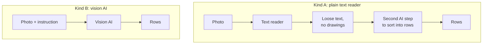
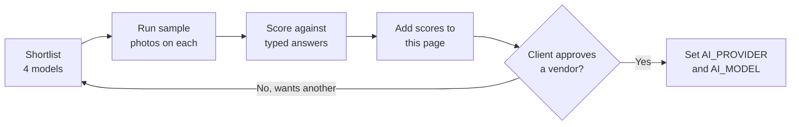

# AI Photo Reading: Price Estimate and Vendor Options

> **Target Audience:** The client, and whoever helps the client pick the AI vendor.
> **Purpose:** Explain the two kinds of tools we looked at, why we picked AI that can see pictures, what each vendor costs per photo and per month, and how the final vendor will be chosen.

**Status: waiting for the client to choose a vendor.** The server already supports every vendor marked "Supported" below, so the choice can be made or changed later with a settings change, without rebuilding anything.

**Prices were checked on 22 September 2026.** They change often. Check again before signing up.

Back to [README.md](README.md).

---

## 1. How to Read the Money in This Page

- Every price is shown in US dollars with the rupee value in brackets, like **$2 (₹192)**.
- The rate on the day was ₹95.53 for 1 USD. We use **₹96 for 1 USD** to leave a small buffer for rate changes and card fees.
- Rupee values are rounded to the nearest rupee, except amounts under ₹100, which keep two decimals. A cost per photo is a fraction of a rupee, so it is shown to the paisa, like **₹0.50**.
- **Rupee values do not include GST** (see section 7).

---

## 2. The Two Kinds of Tools

**Kind A: plain text readers (OCR).** Examples: Google Document AI, AWS Textract, Azure Document Intelligence.

- They are cheap.
- They only turn the photo into loose text. They do not understand drawings, arrows or grouping brackets.
- They do not know which number is the width and which is the count, so a second AI step would still be needed to sort the text into rows.

**Kind B: AI models that can see pictures (vision AI).** Examples: Gemini, GPT, Claude, Mistral, Qwen.

- We send the photo with an instruction like "list every glass piece as width, height, count, glass type, edge work".
- They reply with clean rows we can put straight into the table.
- They understand drawings, brackets and notes, and the rows come back in the shape we need.



---

## 3. Why We Chose Kind B

- Our photos carry meaning in **drawings, arrows and brackets**, not only in text. Kind A loses all of that.
- Kind A needs a second AI step anyway to turn text into rows, so it is not really cheaper once that is added.
- Kind B does the whole job in one step.
- The price difference is small at our volume. Accuracy matters much more than a few dollars a month.

---

## 4. How AI Prices Work

AI companies charge by "tokens". A token is a small piece of text or picture. The photo and our instruction are the **input**; the rows the AI sends back are the **output**.

To compare fairly, the table assumes one photo costs about **2,000 input tokens** and **1,000 output tokens** (the photo, the instruction and around 20 rows back).

```
cost per photo = (2,000 ÷ 1,000,000) × input price
               + (1,000 ÷ 1,000,000) × output price
```

Example: Gemini 3.8 Flash at $0.75 in and $3.75 out gives (0.002 × $0.75) + (0.001 × $3.75) = **$0.00525, about 50 paise a photo**.

The monthly cost is that figure × **1,500 photos a month** (about 50 a day). Real numbers will be known after testing.

**These are upper bounds.** The app never pays to read the same picture twice: the first reading of an image is stored for good and reused for free. A photo attached to an enquiry and then read on the booking made from it counts as one paid read, however many times it is opened afterwards. How much this saves depends on how often the same sheet comes back, so the table still assumes every photo is paid for.

**Note on the real instruction.** Since these estimates, the instruction sent with each photo has grown (detailed rules plus the product list), and the AI now writes a short analysis before the rows. With Gemini's `high` thinking level this adds a few thousand output tokens per photo. That is still well under a cent per photo, but real costs will be above the 2,000 / 1,000 assumption. The measured cost per photo is recorded on every reading (`input_tokens`, `output_tokens`), so section 9 can be filled with real numbers.

---

## 5. Comparison Table

"Supported" means the server has a ready adapter for this vendor and it can be switched on with a setting.

| Provider | Model | Input price (per 1M tokens) | Output price (per 1M tokens) | **Cost per photo** | Cost per month (1,500 photos) | Reads drawings and arrows? | Supported in our server? | Bills in INR? | Notes |
|---|---|---|---|---|---|---|---|---|---|
| Google | Gemini 3.1 Flash-Lite | $0.25 (₹24) | $1.50 (₹144) | **$0.0020 (₹0.19)** | about $3.00 (₹288) | Partly | Yes | No, USD only | Cheapest Google option. Free tier for testing. |
| Google | Gemini 3.8 Flash | $0.75 (₹72) | $3.75 (₹360) | **$0.00525 (₹0.50)** | about $7.88 (₹756) | Yes | Yes | No, USD only | Free tier for testing. **Price doubles on 1 January 2027**, to $0.0105 (₹1.01) per photo. |
| Google | Gemini 3.1 Pro | $2.00 (₹192) | $12.00 (₹1,152) | **$0.0160 (₹1.54)** | about $24.00 (₹2,304) | Yes | Yes | No, USD only | Strongest Google model. Ranks near the top in public handwriting tests. |
| OpenAI | GPT-5.6 Luna | $0.20 (₹19.20) | $1.20 (₹115) | **$0.0016 to $0.0040 (₹0.15 to ₹0.38)** | about $2.40 to $6.00 (₹230 to ₹576) | Partly | Yes | No, USD only | Cheap per token, but may count a photo as many more tokens, so the real cost can be higher. |
| OpenAI | GPT-5.6 Terra | $2.00 (₹192) | $12.00 (₹1,152) | **$0.0160 (₹1.54)** | about $24.00 (₹2,304) | Yes | Yes | No, USD only | Middle option. |
| OpenAI | GPT-6 Astra | $10.00 (₹960) | $50.00 (₹4,800) | **$0.0700 (₹6.72)** | about $105.00 (₹10,080) | Yes | Yes | No, USD only | Top model. GPT models lead public handwriting tests, but this one is expensive for our use. |
| Anthropic | Claude Haiku 4.5 | $1.00 (₹96) | $5.00 (₹480) | **$0.0070 (₹0.67)** | about $10.50 (₹1,008) | Partly | Yes | No, USD only | Fast. Shrinks large photos, which can hurt small handwriting. |
| Anthropic | Claude Sonnet 5 | $2.00 (₹192) | $10.00 (₹960) | **$0.0140 (₹1.34)** | about $21.00 (₹2,016) | Yes | Yes | No, USD only | Middle option. |
| Anthropic | Claude Opus 5 | $5.00 (₹480) | $25.00 (₹2,400) | **$0.0350 (₹3.36)** | about $52.50 (₹5,040) | Yes | Yes | No, USD only | Keeps photos at full size, which helps with small writing. |
| Mistral | Mistral Small 4 | $0.15 (₹14.40) | $0.60 (₹57.60) | **$0.0009 (₹0.09)** | about $1.35 (₹130) | Partly | Yes | No INR price found | Very cheap. Accuracy on messy handwriting unknown. |
| Mistral | Mistral OCR 4.1 | $4 (₹384) per 1,000 pages | (included) | **$0.0040 (₹0.38)** + a second step | about $6.00 (₹576) + a second step | No | No | No INR price found | Kind A. Text only, needs a second AI step. |
| Alibaba | Qwen VL Plus | $0.14 (₹13.44) | $0.41 (₹39.36) | **$0.0007 (₹0.07)** | about $1.04 (₹99) | Partly | Yes | No INR price found | Very cheap. Can also run on our own server for free, but that needs a costly graphics card machine. |
| Google / AWS / Azure | Document AI, Textract, Document Intelligence | $1.50 (₹144) per 1,000 pages | (included) | **$0.0015 (₹0.14)** + a second step | about $2.25 (₹216) + a second step | No | No | Yes, billed in INR but priced in USD and converted | Kind A. Text only, weak on messy handwriting and drawings. |

**Reading the "cost per photo" column.** These are fractions of one rupee. The cheapest option reads a photo for about **7 paise**, the dearest for about **₹6.72**. Even the dearest is far less than the few minutes of staff time it replaces.

**Batch discount.** All the big AI companies give 50% off if we can wait up to a few hours for the answer. We do not want that here, because staff wait on the screen.

**Watch out for "thinking".** Some models (Gemini Pro, GPT Terra and Astra, Claude Sonnet and Opus) can "think" before answering, and that thinking is charged as output. For most vendors keep it off or low, or the cost can double or triple. The one exception we chose on purpose: on Gemini, `GEMINI_THINKING_LEVEL=high` made a big accuracy difference on messy hand-drawn sheets for well under a cent per photo.

---

## 6. What the Table Tells Us

- **Reusing stored readings cuts the real bill further.** The monthly figures assume every photo is new. Repeats cost nothing.
- **Cost is not the problem.** Every sensible option reads a photo for **under ₹2**, most for well under ₹1. Only the top OpenAI model is dear at ₹6.72. At 1,500 photos a month that is $105 (₹10,080) at worst, and under $25 (₹2,400) for almost everything else. **Choose on accuracy, not price.**
- **Kind A tools are not a good fit.** Cheap, but they lose the drawings and grouping, and need a second AI step anyway.
- **We must test on our own photos.** Public handwriting tests put GPT and Gemini near the top, but none of them use glass order sheets.

---

## 7. Paying in Rupees, and GST

- **None of the AI vendors in the table publish API prices in rupees.** Google (Gemini API), OpenAI, Anthropic, Mistral and Alibaba (Qwen) all price their APIs in US dollars.
- OpenAI and Anthropic accept rupees for their **chat subscriptions** (ChatGPT and Claude plans), but **not for API use**, which is what this feature needs.
- **AWS, Azure and Google Cloud** can bill in rupees with a GST invoice, but the price is still set in dollars and converted each month. Only the Kind A text readers in the last row come from these.
- **Card fees.** Paying in dollars with an Indian card usually adds about 2 to 3% for the currency change. The ₹96 rate partly covers this.
- **GST.** Indian businesses pay **18% GST** on these services. With a USD bill it is paid by the business itself (reverse charge). With an INR bill from AWS, Azure or Google Cloud it is on the invoice. A GST-registered business can usually claim it back.

---

## 8. How the Vendor Will Be Chosen

1. **Test.** Run the sample photos through a shortlist of 4 models: Gemini 3.8 Flash, Gemini 3.1 Pro, GPT-5.6 Terra, Claude Sonnet 5.
2. **Score.** Type up the correct answers for each photo by hand (the answer sheet), then count how many values each model got right.
3. **Share.** Add the scores to section 9 next to each model's price.
4. **Client picks** based on price and accuracy.
5. **Switch it on.** Set `AI_PROVIDER` and `AI_MODEL` in the server settings. No code change. See [AI_EXTRACTION_SETUP.md](AI_EXTRACTION_SETUP.md).



Run the tests with **Read again** (`force=true`) so a stored reading does not hide a difference between vendors.

---

## 9. Test Results

**Not filled in yet.** The only recorded run so far is the prompt refinement work on 2026-10-02: nine difficult sample sheets read as expected on repeat runs with `gemini-3.5-flash-lite` and thinking set to `high`. That was a quality check of the instruction, not a scored comparison between vendors. Details are in `dev-docs/toughened-glass/tasks/feat-ai-image-extraction/2026-10-02-prompt-refinement/PR-backend.md`.

The estimated cost per photo comes from the table above. The measured cost comes from the tokens each read actually used (`input_tokens` and `output_tokens` in `order_photo_reading`). Comparing the two shows whether the 2,000 in / 1,000 out assumption holds for our sheets.

| Model | Values correct | Rows missed | Extra rows | Average time per photo | Estimated cost per photo | Measured cost per photo |
|---|---|---|---|---|---|---|
| Gemini 3.8 Flash | | | | | $0.00525 (₹0.50) | |
| Gemini 3.1 Pro | | | | | $0.0160 (₹1.54) | |
| GPT-5.6 Terra | | | | | $0.0160 (₹1.54) | |
| Claude Sonnet 5 | | | | | $0.0140 (₹1.34) | |

**If the client wants a pick without waiting for tests:** Gemini 3.8 Flash is the safest start. About **50 paise** a photo, a free tier for testing, and it handles drawings. Its price doubles in January 2027, which still only takes it to about ₹1.01 a photo, or $16 (₹1,536) a month at our volume.

---

## 10. Sources

- [Google Gemini API pricing](https://ai.google.dev/gemini-api/docs/pricing)
- [OpenAI API pricing](https://developers.openai.com/api/docs/pricing)
- [Anthropic Claude pricing](https://platform.claude.com/docs/en/about-claude/pricing) and [Claude image sizes](https://platform.claude.com/docs/en/build-with-claude/vision)
- [Mistral pricing](https://mistral.ai/pricing/api/)
- [Qwen VL Plus pricing](https://pricepertoken.com/pricing-page/model/qwen-qwen-vl-plus)
- [Google, AWS and Azure text reading prices](https://imagetotable.ai/blog/google-vs-aws-vs-azure-ocr-2026)
- [Handwriting test with 14 AI and OCR tools](https://aimultiple.com/handwriting-recognition)
- [Gemini API prices in rupees (USD billing, bank fees)](https://www.equityresearchindia.com/post/google-gemini-ai-pricing-in-india-2026)
- [Paying for the Claude API from India (USD only, 18% GST)](https://matchyoursaas.com/blog/paying-anthropic-claude-from-india-2026)
- [Anthropic rupee billing for Claude subscriptions](https://techstory.in/anthropic-launches-rupee-billing-for-claude-in-india-its-second-largest-market-after-the-us/)
- [AWS India billing in INR](https://docs.aws.amazon.com/awsaccountbilling/latest/aboutv2/edit-aispl-payment-method.html)
- [Azure Document Intelligence pricing (India)](https://azure.microsoft.com/en-in/pricing/details/document-intelligence/)
