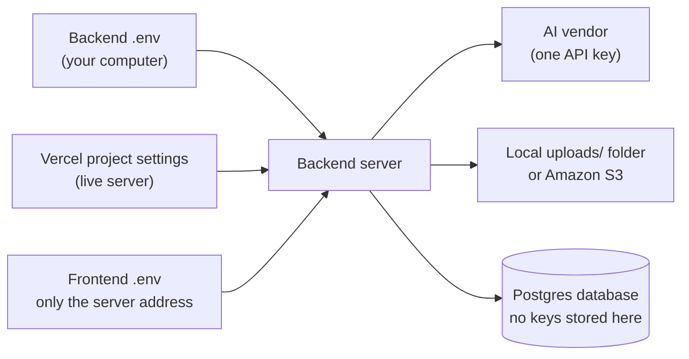

# AI Photo Reading: Setup Guide (Accounts, Keys and Settings)

> **Target Audience:** Whoever sets up a developer machine or the live server for the toughened-glass app.
> **Purpose:** Every account, key and setting the photo reading feature needs, and exactly where each one goes.

Back to [README.md](README.md). How the feature is built is in [AI_EXTRACTION_DEVELOPER_GUIDE.md](AI_EXTRACTION_DEVELOPER_GUIDE.md).

---

## 1. In Short

- **All keys go in the backend `.env` file** (and in Vercel's settings for the live server). Nothing goes in the database, and nothing goes in the frontend.
- **You only need one AI vendor account to go live:** the one the client picks from [AI_EXTRACTION_PRICING.md](AI_EXTRACTION_PRICING.md). Create others only if you want to test them first.
- **Photos are stored on the server's own disk for now.** An Amazon S3 account is only needed before going live on Vercel.
- **The app runs without any AI key.** When `AI_PROVIDER` is empty, staff can still attach photos; the dialog just says reading is not set up.
- **The AI is only used on Order Booking** (Read from photo on the Products table). The Enquiry screen only attaches photos and needs no key.
- **The same photo is never paid for twice.** The app fingerprints each image and keeps the rows it read for good.
- **Nothing is deleted yet.** Storage only grows until the cleanup job is written. See the developer guide, section 3, Step 3.



---

## 2. Before Anything Else: Your Local Database

If the backend `.env` still has the sample database password from `.env.example` (`postgres:postgres`) and your local Postgres uses a different one, the server cannot connect.

| Setting | File | What to put |
|---|---|---|
| `DATABASE_URL` | `rubine-toughened-glass-backend/.env` | `postgresql://postgres:<your password>@localhost:5432/rubine_toughened_glass` |

Then run these once from the backend folder:

```bash
npm run migrate
```

```bash
npm run seed
```

Both are safe to run again; they only apply files not applied yet. The two photo tables (`public.order_photo` and `public.order_photo_reading`) come with the main schema migration (`001_multi_tenant_schema.sql`). The `ai_extraction` rights come with the RBAC seed. No extra seed data is needed.

---

## 3. AI Vendor Accounts

Pick the vendor the client approved, create the account, and put three values in the backend `.env`: `AI_PROVIDER`, `AI_MODEL`, and that vendor's key. The server refuses to start if `AI_PROVIDER` is set but its key or `AI_MODEL` is missing, so a mistake shows up straight away.

**Always set a monthly spending limit** on the vendor's billing page.

### 3.1 Google Gemini

1. Go to [Google AI Studio](https://aistudio.google.com) and sign in with a Google account.
2. Click **Get API key**, then **Create API key**. This creates a Google Cloud project for you.
3. For the paid tier, link a billing account to that project. The free tier is fine for testing, but Google may use free tier data to improve its products, so **use the paid tier for real customer photos**.

| Setting | Value |
|---|---|
| `AI_PROVIDER` | `gemini` |
| `AI_MODEL` | `gemini-3.8-flash` (or the model the client picked, spelled exactly as in AI Studio). In our own check on one sheet, `gemini-3.5-flash` and `gemini-3.6-flash` performed well and `gemini-3.5-flash-lite` did not (see the pricing page, section 9). |
| `GEMINI_API_KEY` | The key from AI Studio |
| `GEMINI_THINKING_LEVEL` | Optional. `high` reads messy hand-drawn sheets much better (a few seconds and a few thousand output tokens more per photo). Leave empty for Gemini 2.5 and older. |

### 3.2 OpenAI

1. Go to the [OpenAI Platform](https://platform.openai.com) and create an account and an organisation.
2. Open **Settings > Billing** and add credit.
3. Open **API keys** and create a key for a project.

| Setting | Value |
|---|---|
| `AI_PROVIDER` | `openai` |
| `AI_MODEL` | `gpt-5.6-terra` (or the model the client picked) |
| `OPENAI_API_KEY` | The key from the platform (starts with `sk-`) |

### 3.3 Anthropic Claude

1. Go to the [Claude Console](https://platform.claude.com) and create an account and an organisation.
2. Open **Billing** and add credit.
3. Open **API keys** and create a key.

| Setting | Value |
|---|---|
| `AI_PROVIDER` | `anthropic` |
| `AI_MODEL` | `claude-sonnet-5` (or `claude-haiku-4-5` or `claude-opus-5`) |
| `ANTHROPIC_API_KEY` | The key from the console (starts with `sk-ant-`) |

### 3.4 Mistral

1. Go to the [Mistral console](https://console.mistral.ai) and create an account.
2. Choose a plan and add a payment method.
3. Open **API keys** and create a key.

| Setting | Value |
|---|---|
| `AI_PROVIDER` | `mistral` |
| `AI_MODEL` | `mistral-small-latest` (or `mistral-medium-latest`) |
| `MISTRAL_API_KEY` | The key from the console |

### 3.5 Alibaba Qwen

1. Create an **international** account at [Alibaba Cloud](https://www.alibabacloud.com).
2. Open **Model Studio** and activate it.
3. Create an API key in Model Studio.

| Setting | Value |
|---|---|
| `AI_PROVIDER` | `qwen` |
| `AI_MODEL` | `qwen-vl-plus` (or `qwen-vl-max`) |
| `QWEN_API_KEY` | The key from Model Studio |
| `QWEN_BASE_URL` | Leave the default (`https://dashscope-intl.aliyuncs.com/compatible-mode/v1`) unless your key is for a different region |

### 3.6 Checking the AI setup

Restart the backend after setting the values. Open an order booking, click **Read from photo** on the Products table, and upload one sample photo. (The Enquiry screen only attaches photos, so it never shows an AI error even when the key is wrong.) If the key or model name is wrong, the dialog shows the vendor's error message, and it is also saved in `order_photo_reading.error_message`.

---

## 4. Photo Storage

### 4.1 Now: local folder (nothing to create)

| Setting | Value |
|---|---|
| `STORAGE_DRIVER` | `local` |
| `LOCAL_STORAGE_DIR` | `uploads` (a folder inside the backend folder, already in `.gitignore`) |

Two files are written per photo: the image itself, and the rows the AI read, saved as `<photo-id>.reading.json` next to it, for example `uploads/order-photos/2026/09/<photo-id>.jpg`. Both move to S3 together when the driver is switched.

### 4.2 Later: Amazon S3 (needed before going live on Vercel)

Vercel cannot keep files on its own disk, so the live server must use S3.

1. Create an [AWS account](https://aws.amazon.com). Indian businesses are billed by AWS India in rupees with a GST invoice.
2. In **S3**, create a bucket, for example `rubine-order-photos`, in the **Asia Pacific (Mumbai) `ap-south-1`** region. Leave **Block all public access** turned on. The bucket stays private because photos reach the browser through the server, not through public links. No CORS setup is needed.
3. In **IAM**, create a user for the app (no console access) and attach this policy, with your bucket name:

```json
{
  "Version": "2012-10-17",
  "Statement": [
    {
      "Effect": "Allow",
      "Action": ["s3:PutObject", "s3:GetObject", "s3:DeleteObject"],
      "Resource": "arn:aws:s3:::rubine-order-photos/order-photos/*"
    }
  ]
}
```

4. Create an **access key** for that user (use case: "Application running outside AWS") and copy both parts.

| Setting | Value |
|---|---|
| `STORAGE_DRIVER` | `s3` |
| `S3_BUCKET` | `rubine-order-photos` |
| `S3_REGION` | `ap-south-1` |
| `S3_ACCESS_KEY_ID` | From step 4 |
| `S3_SECRET_ACCESS_KEY` | From step 4 |
| `S3_ENDPOINT` | Leave empty for Amazon S3. Only set it for an S3-compatible service like Cloudflare R2 or MinIO. |

Photos saved while `STORAGE_DRIVER=local` still open after switching to `s3`, because each photo remembers where it was saved. To move them to S3, copy the `uploads/order-photos` folder into the bucket under `order-photos/`, then set `storage_driver` to `s3` on those rows in the `order_photo` table.

---

## 5. The Live Server on Vercel

In the backend's Vercel project, open **Settings > Environment Variables** and add the same settings as the backend `.env`:

- `AI_PROVIDER`, `AI_MODEL` and the chosen vendor's key (and `GEMINI_THINKING_LEVEL` for Gemini)
- `STORAGE_DRIVER=s3` and all the `S3_` settings
- `PHOTO_MAX_MB` and `PHOTO_READS_PER_MINUTE` if you want limits other than the defaults

Reading a photo can take up to about a minute, and `AI_TIMEOUT_MS` is 60 seconds by default. Check the backend function's time limit on Vercel is longer than that. With Vercel's current defaults it usually is, but it depends on the plan.

---

## 6. All Settings in One Table

All of these go in `rubine-toughened-glass-backend/.env`. The same list, with comments, is in `.env.example`.

| Setting | Needed when | Default | What it does |
|---|---|---|---|
| `AI_PROVIDER` | To switch reading on | empty (reading off) | `gemini`, `openai`, `anthropic`, `mistral` or `qwen` |
| `AI_MODEL` | `AI_PROVIDER` is set | none | The exact model name at that vendor |
| `AI_TIMEOUT_MS` | Never | `60000` | How long to wait for the vendor before giving up |
| `GEMINI_THINKING_LEVEL` | Never | empty | Gemini only: `minimal`, `low`, `medium` or `high` |
| `GEMINI_API_KEY` | `AI_PROVIDER=gemini` | none | Google AI Studio key |
| `OPENAI_API_KEY` | `AI_PROVIDER=openai` | none | OpenAI key |
| `ANTHROPIC_API_KEY` | `AI_PROVIDER=anthropic` | none | Claude Console key |
| `MISTRAL_API_KEY` | `AI_PROVIDER=mistral` | none | Mistral key |
| `QWEN_API_KEY` | `AI_PROVIDER=qwen` | none | Alibaba Model Studio key |
| `QWEN_BASE_URL` | Never | Singapore endpoint | Qwen's address |
| `STORAGE_DRIVER` | Never | `local` | `local` or `s3` |
| `LOCAL_STORAGE_DIR` | Never | `uploads` | Folder for local photos |
| `S3_BUCKET` | `STORAGE_DRIVER=s3` | none | Bucket name |
| `S3_REGION` | `STORAGE_DRIVER=s3` | none | For example `ap-south-1` |
| `S3_ACCESS_KEY_ID` | `STORAGE_DRIVER=s3` | none | IAM access key |
| `S3_SECRET_ACCESS_KEY` | `STORAGE_DRIVER=s3` | none | IAM secret key |
| `S3_ENDPOINT` | Only for R2 or MinIO | empty | S3-compatible address |
| `PHOTO_MAX_MB` | Never | `6` | Biggest upload the server accepts (upload route only) |
| `PHOTO_READS_PER_MINUTE` | Never | `10` | Reads allowed per user per minute |

The frontend needs nothing new. Its only setting is `VITE_API_URL`, the backend address. **Never put an AI key in the frontend**, because anyone using the app could read it.

After changing any of these, restart the backend. Settings are read once at startup.

---

## 7. Keeping Keys Safe

- Never commit `.env`. It is already in `.gitignore`.
- Use a separate key for local testing and for the live server, so one can be turned off without breaking the other.
- If a key is ever shared by mistake, delete it at the vendor straight away and create a new one.
