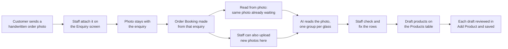

# AI Photo Reading (Order Sheets)

Customers send photos of handwritten glass orders. Staff used to type every size in by hand. This feature lets the app read the photo with an AI model, turn it into rows (sizes, quantities, holes, cutouts, glass type), and hand those rows to a person to check before anything is saved.

**Status (checked against the `dev` branch of both repos on 2026-10-07):** built and merged. The AI vendor is still not chosen by the client, so on a fresh setup reading stays switched off until `AI_PROVIDER` is set. Photos are stored on the server's own disk for now. The cleanup job for old photos is not written yet.

## Which file to read

| File | Who it is for | What it covers |
|---|---|---|
| [AI_EXTRACTION_INFO.md](AI_EXTRACTION_INFO.md) | Business owners, office staff, anyone non-technical | What the feature does, the step-by-step flow, what each field means, and common questions. |
| [AI_EXTRACTION_DEVELOPER_GUIDE.md](AI_EXTRACTION_DEVELOPER_GUIDE.md) | Developers and AI agents | Data fields and database columns, the rules the app enforces, how the server and screens are built, every route, the AI instruction rules, open gaps, and how to test. |
| [AI_EXTRACTION_SETUP.md](AI_EXTRACTION_SETUP.md) | Whoever sets up a machine or the live server | Every account, key and setting, and where each one goes. |
| [AI_EXTRACTION_PRICING.md](AI_EXTRACTION_PRICING.md) | The client and whoever picks the vendor | The kinds of tools we looked at, the price of every vendor, and how the vendor will be chosen. |
| [AI_EXTRACTION_PROMPT.md](AI_EXTRACTION_PROMPT.md) | Developers and anyone tuning the AI | An example of the API call sent to the AI vendor, and the exact prompt text, on its own. |

Past task records for this feature are in `dev-docs/toughened-glass/tasks/feat-ai-image-extraction/`.

## The feature in one picture

## Things still to agree with the client

1. **Which AI vendor.** Decided by the client after the price estimate. See [AI_EXTRACTION_PRICING.md](AI_EXTRACTION_PRICING.md).
2. **Where photos live in production.** The server's own disk for now, Amazon S3 later. The live backend runs on Vercel, which cannot keep files on disk, so a live Vercel deployment needs S3.
3. **Customer privacy.** Photos go to an outside AI company. The big vendors say they do not learn from paid API data by default, but this must be confirmed for the vendor we pick, and the customer should be fine with it.
4. **Inches or millimetres** when a sheet does not say. Today: numbers with fractions like "½" are read as inches, plain numbers above 100 as millimetres, and staff confirm in the review panel.
5. **Glass type names.** We need the list of ways staff and customers write glass types ("tuff", "toughened", "clear", "frosted") matched to our product list. The app already expands common shorthand, but the product master is the source of truth, and anything missing from it shows as a warning.
6. **Products customers ask for that we do not have on file** (for example "R/G Frosted"). These are flagged, not blocked. Someone has to decide whether they get added to the master over time or staff keep picking a product by hand.
7. **Monthly budget limit** on the AI vendor account.
8. **How long a stored reading stays good.** A reading is reused forever, because the same image always means the same sheet. If the instruction sent to the AI changes (or the product master changes), old readings still come from the old instruction until someone clicks **Read again**.
9. **How long photos are kept.** Nothing is deleted today. The client has to say how long an order sheet must be kept, and whether photos on cancelled enquiries and bookings can go sooner, before the cleanup job can be written.
10. **Opposite sides with different numbers** (for example 2762 on one side and 2742 on the other). Today the AI is told to take the larger one, note both, and flag it. This was the developer's guess at the shop rule and still needs to be confirmed.
