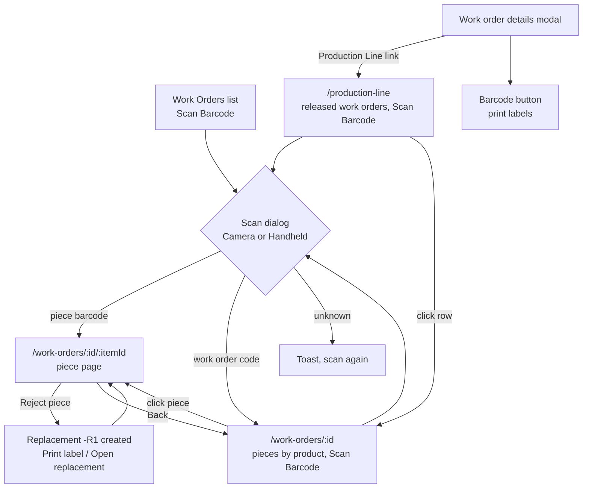

# Barcodes & Production Line Developer Guide: Required Fields & Implementation

> **Target Audience:** Developers and AI Agents.
> **Purpose:** A full reference for per-piece work order items, barcode labels, scanning, piece rejection with replacement, and the Production Line in toughened-glass. Everything here was checked against the `dev` branch of `rubine-toughened-glass-backend` and `rubine-toughened-glass-frontend` on 2026-10-07. Where the code differs from the original plan (`toughened-glass/barcode-scanner-plans/Plan.md`), the code wins and the difference is listed in section 8.

---

## 1. Required Fields & Originating Modules

The feature spans four places: **the work order** (made from an order booking), **the pieces** (one `work_order_item` per physical piece), **the stages** (one `work_order_process` row per piece per work centre on its route), and **the order booking size row** each piece was cut from.

### 1.1 One Piece (`production.work_order_item`)
*Created when a work order is made (`createWorkOrderInTx` in `src/modules/work-order/work-order.repository.ts`), or when a piece is rejected (replacement). Per-piece columns added by `src/database/migrations/037_work_order_item_per_piece.sql`; barcode and review columns came earlier in `035` and `036`.*

| Field | Required | Where to Fill in App | Database Column | Notes |
|---|---|---|---|---|
| **Work order** | Yes | Auto | `work_order_item.work_order_id` | |
| **Product (booking line)** | Yes | Auto | `work_order_item.order_booking_item_id` | Pieces are grouped by this. There is no unique constraint on `(work_order_id, order_booking_item_id)`, so many pieces share one product. Indexed together with `work_order_id`. |
| **Size row** | Optional | Auto | `work_order_item.order_booking_size_id` | Which booking size (W x H, holes, cutouts, shape) this piece is. Foreign key to `sales.order_booking_size`. Older pieces made before sizes were tracked fall back to the product's sizes. |
| **Piece number** | Optional | Auto | `work_order_item.piece_no` | 1..N within its product. A replacement keeps the same number. Must be above 0. |
| **Quantity** | Yes | Auto | `work_order_item.quantity` | Always 1 per piece. `produced_quantity` is 0 or 1. |
| **Barcode** | Yes | Auto | `work_order_item.barcode_value` | Unique. See section 1.4 for the format. |
| **Piece status** | Yes | Auto / Reject piece | `work_order_item.piece_status` | `ACTIVE` (default) or `REJECTED` (check constraint). |
| **Rejection** | Optional | Reject piece dialog | `rejection_reason`, `rejected_at`, `rejected_by` | Reason is required in the UI and API, up to 500 characters. `rejected_by` points at `core.app_user`. |
| **Replaces** | Optional | Auto | `work_order_item.replaces_item_id` | On a replacement, the piece it replaces. Gives the chain R1, R2... |
| **Review** | Yes | Work order details (Approve / Deny per product) | `review_status`, `review_notes`, `reviewed_by`, `reviewed_at` | Stays per **product**: approving or denying one piece updates every piece of that product, rejected ones included, so a later replacement has the same review. |
| **Product details** | Yes | Auto (from booking) | `product_id`, `sub_product_id`, `thickness`, `glass_code`, `layer`, `actual_chargeable_area` | Copied to a replacement. |

Unique index `uq_work_order_item_active_piece` on `(work_order_id, order_booking_item_id, piece_no)` where `piece_status = 'ACTIVE'`: at most one live piece per number in a product.

---

### 1.2 One Stage of One Piece (`production.work_order_process`)
*Created with each piece, one row per work centre on the product's route.*

| Field | Required | Where to Fill in App | Database Column | Notes |
|---|---|---|---|---|
| **Piece** | Yes | Auto | `work_order_process.work_order_item_id` | Unique together with `sequence_no`, so every piece has its own stages. |
| **Work centre and order** | Yes | Auto (product route) | `work_center_id`, `sequence_no` | CUT, GRN, HOLE, FAB, TMP, store. |
| **Status** | Yes | Piece page (Start / Complete) or Stages dialog | `work_order_process.status` | `PENDING`, `IN_PROGRESS`, `COMPLETED`, `SKIPPED`. SKIPPED counts as done. |
| **Times and person** | Optional | Auto | `started_at`, `completed_at`, `updated_by` | `updated_by` keeps only the last person who touched the stage. |
| **Rejection at this stage** | Optional | Reject piece | `rejected_quantity`, `rejection_reason` | Set on the stage the piece was at when rejected (first unfinished stage, or the last stage if all were done). |

---

### 1.3 What a Stage Asks the Operator (from the booking's process details)
*Read by `stageDetailFor()` in `src/modules/production-scan/production-scan.service.ts`, keyed by work centre code.*

| Work centre code | Shown on the piece page | Comes from |
|---|---|---|
| `CUT` | Cutting type, remark | Booking cutting details |
| `GRN` | Edge type and thickness, grinding type and thickness, remark | Booking edge details |
| `HOLE` | Hole counts (from the piece's size) | Size row |
| `FAB` | Remark | Booking fabrication details |
| `TMP` | Load direction, wave limits, bend limits, heat soaking and its process, remark | Booking tempering details |
| anything else | Store remark | Booking store details |

---

### 1.4 Barcode Format and Label Fields

| Item | Format | Example |
|---|---|---|
| Original piece | `RB-<work order code>-<product NN>-<piece NNN>` | `RB-WO-0042-01-007` |
| Replacement | adds `-R<n>`, counted along the chain of that piece number | `RB-WO-0042-01-007-R1`, then `-R2` |

At most about 21 characters, fine for Code 128. Barcode lookups ignore upper or lower case.

The label (`BarcodeLabel` in `src/lib/pdf/barcode-pdf.ts`) carries: barcode (Code 128 image made with `jsbarcode`, plus the text), work order code, party, product (with sub product), thickness, this piece's width and height, holes (hole + centre hole + big hole), cutouts, piece n / N, replacement number, route (work centre codes joined with " / "), and a date (the work order's approval date). Formats: `A4` (10 labels per sheet, default) or `THERMAL` (100 x 50 mm, one per page, landscape).

---

## 2. Eligibility & Validation Rules Checklist

1. **Rights:** every `/production-scan` route needs login and the `barcode_scanner` module: `VIEW` for the list, pieces and lookups, `CONTROL` for start, complete and reject. The permission code stays `barcode_scanner`; seed `013_rename_barcode_scanner_right.sql` only changes the display names to "Production Line", "Production Line - View" and "Production Line - Control". Piece pages under `/work-orders/...` need `work_order` VIEW to open.
2. **Released only:** only work orders with status `IN_PROGRESS` or `COMPLETED` (both Party and Factory approved) appear on the Production Line and can be opened by id (404 `SCAN_ITEM_NOT_FOUND` otherwise).
3. **Barcode lookup:** unknown barcode gives 404 `BARCODE_NOT_FOUND`. A known barcode on a work order not yet released gives 400 `WORK_ORDER_NOT_APPROVED`. A barcode is 1 to 64 characters.
4. **Starting a stage** (`POST /production-scan/:id/scan` with `{ barcode }`): refused with 400 if the piece is rejected (`SCAN_PIECE_REJECTED`, naming the replacement), the work order is completed (`SCAN_ALL_STAGES_DONE`), or not released (`WORK_ORDER_NOT_APPROVED`). The barcode in the body must be this piece's own, ignoring case (400 `SCAN_BARCODE_MISMATCH`), and is required (validation error when missing). It starts the first stage that is not done. If that stage is already in progress, nothing changes.
5. **Completing a stage:** only a stage that was started can be completed (400 `SCAN_STAGE_NOT_STARTED`). Completing the last stage marks the piece produced.
6. **Rejecting a piece:** reason required. Work order must be released. A piece already rejected cannot be rejected again. Works on a Completed work order too (it reopens it).
7. **Manual stage updates (Stages dialog on the work order):** only once the work order is approved. A stage can start, finish or be skipped only when every earlier stage of that product is done, and can go back to PENDING only while no later stage has started. Changes apply to all live pieces of the product.
8. **Work order status roll-up:** Completed only when every stage of every **counted** piece is `COMPLETED` or `SKIPPED`. Counted means `piece_status = 'ACTIVE'` and `review_status <> 'DENIED'`. It goes back to In Progress when a stage is reopened or a replacement is added.
9. **Label printing:** the per product **Barcode** button only shows after Factory approval (`adminApproved`). It prints live (`ACTIVE`) pieces only. **Print Scan Code** in the work order Print menu is disabled until the work order is approved.
10. **Production Line link** in the work order details modal only shows with `barcode_scanner` VIEW and when the work order is `IN_PROGRESS` or `COMPLETED`.

---

## 3. Implementation Guide (pending steps)

The backend and screens are built. What is left is decisions and small follow ups, not new architecture.

```text
┌─────────────────────────────────────────────────────┐
│   Backend: per-piece items, scan / complete /       │
│   reject, status roll-up, final invoice hand-off    │
│          (NO CHANGES NEEDED - COMPLETE)             │
└─────────────────────┬───────────────────────────────┘
                      │
                      ▼
┌─────────────────────────────────────────────────────┐
│   Frontend: Work Orders pages, piece page, scan     │
│   dialog, label PDF, Production Line list           │
│          (WORKING, small gaps below)                │
└─────────────────────┬───────────────────────────────┘
                      │
                      ▼
┌─────────────────────────────────────────────────────┐
│  1. Decide: scan to start, or scan once (product)   │
└──────────────┬──────────────────────────────────────┘
               │
               ▼
┌─────────────────────────────────────────────────────┐
│  2. Merge or drop feat/barcode camera Capture commit│
└──────────────┬──────────────────────────────────────┘
               │
               ▼
┌─────────────────────────────────────────────────────┐
│  3. Fix the Production Line ?workOrderId link       │
└─────────────────────────────────────────────────────┘
```

### Step 1: Decide how a stage is started
The plan said a stage can only be started by scanning that piece's own label at the station. The current `dev` code (commit `281a48a`, 2026-10-05, "scan-once flow") changed this: once a piece's page is open, **Approve / Start Stage** sends the piece's own barcode straight to the scan API, so no second scan is needed. The server check is still there, but the page always passes it. If the product team wants scan to start back, `ScanDialog` still has a verify mode (`expectedBarcode` + `onMatched`) that can be wired to the Start button in `scan-detail-page.tsx`.

### Step 2: The camera Capture change on `feat/barcode`
`dev` reads the camera live (a decode every 120 ms, `use-barcode-camera.ts`). Commit `adb0372` on `feat/barcode` (frontend, 2026-10-06, not merged) replaces this with a **Capture** button that takes one full resolution still of only the framed area and reads it with `zxing-wasm` alone, because the phone's built-in reader could clip the last characters. Decide whether to merge it. A live camera has not been tried on a real phone yet in either version.

### Step 3: The Production Line link
The work order details modal links to `/production-line?workOrderId=<id>`, but the Production Line page on `dev` does not read `workOrderId` (and does not handle `?barcode=` either). The link opens the full, unfiltered list. Either make the page read the parameter or point the link at `/work-orders/<id>`, which already shows that work order's pieces.

---

## 4. What Already Works (Zero Changes Needed)

1. **Per-piece creation:** a product with qty 10 becomes 10 items, each with its own barcode, size row, piece number and stage rows. The plan says editing a product's qty or sizes before approval rebuilds that product's pieces (safe, because nothing is scanned before approval); this was not re-checked line by line for this guide.
2. **Backfill:** migration 037 split existing items into one per piece, copied their stage progress, and handed out sizes in entry order (size A qty 3 gives pieces 1 to 3, size B qty 2 gives pieces 4 to 5). On the local DB 11 items became 37 pieces.
3. **Product level review and stage changes** in the work order details modal, with qty shown as the number of live pieces.
4. **Lists and counts:** item count is distinct products; quantities and stage chips count live pieces only.
5. **Scanning:** camera (Code 128 and QR through `zxing-wasm`, with the `.wasm` file bundled so no third party request is made) and handheld scanner (a focused text box; guns type the code and press Enter). The mode is remembered per device. Camera access problems show a message and offer the handheld tab.
6. **Lookup fallback:** if a scanned value is not a piece barcode but exactly matches a work order code, the work order page opens instead.
7. **Piece page:** stepper, stage panel with what each stage asks for, execution log, Print label, Reject piece, rejected banner with Open replacement, replacement note with a link back.
8. **Reject and replace in one transaction:** marks the piece rejected (with the stage it was at), creates the replacement with the next `-R<n>` barcode and fresh PENDING stages from the first one, **takes raw glass stock for the replacement and logs the breakage** (`issueInventoryForReplacementPieceInTx`), and re-rolls the work order status.
9. **Final invoice hand-off:** when the roll-up turns a work order COMPLETED (from a stage, a skip, or a reject), `ensureFinalInvoiceForWorkOrderInTx` prepares its Final Invoice.
10. **Label PDFs:** real Code 128, A4 or thermal, opened with the print dialog (`autoPrint` + blob URL). The format is remembered per device. Print from the product card (whole product or chosen pieces), the work order Print menu (all live pieces), the piece page, or the reject result dialog.
11. **Production Line list:** KPI cards, status tabs, search, pieces done / total, rejected count, stage chips with per-piece counts on hover, Scan Barcode.

---

## 5. Code Map

### 5.1 Backend (`rubine-toughened-glass-backend`)

```
src/modules/production-scan/
├── production-scan.routes.ts       routes and rights (barcode_scanner VIEW / CONTROL)
├── production-scan.controller.ts
├── production-scan.service.ts      list, pieces, lookup, scan, complete, reject
├── production-scan.repository.ts   SQL (released work orders, piece stats, locks, replacement)
├── production-scan.schema.ts       barcode param, { barcode } to start, { reason } to reject
└── production-scan.types.ts
src/modules/work-order/
├── work-order.repository.ts        createWorkOrderInTx (one item per piece), barcode format,
│                                   per-product review, COUNTED_PIECE, status roll-up
├── work-order.service.ts           syncWorkOrderStatusAndFinaliseInTx, manual stage updates
└── work-order-inventory.service.ts issueInventoryForReplacementPieceInTx
src/database/migrations/037_work_order_item_per_piece.sql
src/database/seeds/013_rename_barcode_scanner_right.sql
```

### 5.2 Frontend (`rubine-toughened-glass-frontend`)

```
src/routes/
├── production-line.tsx                         /production-line (list)
├── work-orders.tsx                             Work Orders list, Scan Barcode
├── work-orders_.$workOrderId.tsx               one work order: pieces grouped by product, Scan Barcode
└── work-orders_.$workOrderId_.$workOrderItemId.tsx   one piece (ScanDetailPage)
src/features/production-scan/
├── production-line-page.tsx      list of released work orders; a row opens /work-orders/<id>
├── work-order-pieces-table.tsx   pieces grouped under products (shared)
├── scan-detail-page.tsx          the piece page
├── scan-dialog.tsx               camera / handheld; lookup or verify mode
├── use-barcode-camera.ts         opens the camera, decode loop
├── barcode-reader.ts             zxing-wasm setup and decode
├── barcode-labels.ts             label mapping, format memory, print
├── label-format-picker.tsx
├── components/                   stepper, stage panel, completed stage panel, log, status badge
├── api.ts, queries.ts, types.ts, stage-utils.ts
src/features/order-booking/
├── work-order-summary-modal.tsx  product cards, Barcode button, Production Line link
├── barcode-print-button.tsx      format + whole product / select pieces
└── work-order-print-menu.tsx     Print Scan Code (every live piece)
src/lib/pdf/barcode-pdf.ts        generateBarcodeLabelsPdf(labels, format)
```

The trailing underscores in the route file names keep the piece route a sibling of the work order route, not a nested child (the list page has no outlet, so a nested child would never render).

### 5.3 Routes (all under `/api/v1/production-scan`, all need login)

| Method | Route | Right | What it does |
|---|---|---|---|
| GET | `/` | VIEW | Production Line list: released work orders with piece stats and stage chips |
| GET | `/by-barcode/:barcode` | VIEW | Look up a piece by its label; returns the piece detail (with `workOrderId`) |
| GET | `/work-orders/:id` | VIEW | One work order's pieces grouped under products |
| GET | `/:id` | VIEW | One piece's detail (`:id` is the work order item id) |
| POST | `/:id/scan` | CONTROL | Start the current stage. Body `{ barcode }` must be this piece's |
| POST | `/:id/complete` | CONTROL | Complete the started stage |
| POST | `/:id/reject` | CONTROL | Body `{ reason }`. Returns `{ rejected, replacement }` |

---

## 6. How It Works Inside

### 6.1 Navigation on `dev`



### 6.2 Reject, step by step (one transaction)

1. Lock the piece. Refuse if already rejected.
2. Lock its stages. The rejection is recorded on the first unfinished stage (or the last if all are done): `rejected_quantity = 1` and the reason.
3. Mark the piece `REJECTED` with reason, time and user. Its finished stages and log stay as history.
4. Count the chain for that product and piece number, strip any old `-R<n>` from the barcode, and create the replacement with `-R<chain>`: same product, sub product, size row, thickness, glass code and piece number, `replaces_item_id` set, fresh `PENDING` stages from the route.
5. Take raw glass stock for the replacement and log the breakage with the stage name and reason.
6. Re-roll the work order status (and prepare the final invoice if it turns Completed).

### 6.3 Status shown per work order

| Status | Meaning |
|---|---|
| Pending | Released, no stage started on any counted piece |
| In Progress | Any stage started (or done) on any counted piece |
| Completed | Every counted piece done |

---

## 7. Open Questions

- **Tracking and activity log (product team's decision, not part of this feature).** Today there is no history of who did what; the database keeps only the current state.
  - `order_booking` and `work_order` have no "created by", and work order approvals store the date but not who approved.
  - `work_order_process.updated_by` holds only the last person to touch a stage: if A starts and B completes, A is lost. Reopening a stage also clears its times.
  - There is no dispatch or delivery table, so "enquired to delivered" cannot be shown yet.
  - Server request logs go to the console only.
  - A possible direction: one append-only activity log (time, user, record, action, before and after) written in the same transaction as each change, a timeline per order and per piece, and separate "started by" and "completed by" on stages. This only works if each worker has their own login.
- **Scan to start or scan once** (section 3, Step 1).
- **Camera Capture commit** (section 3, Step 2).

---

## 8. Differences From the Original Plan, and Known Issues

1. **Piece page moved.** The plan had `/production-line/$workOrderItemId`. Commit `281a48a` (2026-10-05) removed it. The piece page is now `/work-orders/$workOrderId/$workOrderItemId`, and a work order's pieces are on `/work-orders/$workOrderId` (no pieces modal on the Production Line any more).
2. **Production Line left the side menu.** The `/production-line` route still exists and is reached from Scan Barcode results, the work order details modal link, and direct links.
3. **`?workOrderId=` and `?barcode=` are not handled** on `/production-line` (section 3, Step 3).
4. **Scan to start became scan once** (section 3, Step 1). The plan's "Scan to start" button text is now "Approve / Start Stage".
5. **Camera mode on `dev` is a live decode loop.** The plan describes the Capture button, which only exists on `feat/barcode` (`adb0372`).
6. **Extra behaviour not in the plan:** reject takes raw glass stock and logs breakage; a completed work order prepares its Final Invoice; the scan dialog also accepts a work order code; Print Scan Code prints a whole work order's labels; the piece page has its own Print label.
7. **The mock "Barcode (Factory)" option was removed** from the PI Status print menu; labels are printed from Work Orders.
8. **The `production-scan` module and feature folder kept their names**; only routes and display names changed.
9. **Small code comment mismatch:** `barcode-reader.ts` says "our labels carry both" Code 128 and QR, but the label PDF only draws Code 128. The reader still accepts QR (useful for supplier labels).
10. **Not tested yet (from the plan's status table):** a live camera on a real phone over HTTPS (the preview pane blocks cameras), and the thermal PDF beyond its page count. The A4 PDF was checked by eye.

---

## 9. How to Test (end to end)

1. Create a work order with one product of qty 10 and factory approve it. Check there are 10 pieces, barcodes `RB-<WO>-01-001` to `-010`, each with its own stages.
2. Print the 10 labels from the product's **Barcode** button, once in A4 and once in thermal. Scan a printed label with a phone camera to check it reads.
3. Party approve. The work order shows In Progress on the Production Line, status Pending until a stage starts.
4. Open piece 7 by scanning its label with the camera, then with a handheld scanner. The piece page for piece 7 opens both times. Scan an unknown code: a clear "not recognised" message. Scan the work order code: the work order page opens.
5. Start and complete a few stages on piece 7. The Production Line shows In Progress and the stage chips update.
6. Reject piece 7 at grinding with a reason. `...-007-R1` is created, starts from the first stage, its label prints, raw stock is taken, and the old piece opens read-only with the banner. The pieces list shows the rejected piece struck through above R1.
7. Deny another product (if any): its pieces no longer hold the work order open.
8. Run every live piece, including R1, to the last stage. The work order shows Completed only after the last one, and its Final Invoice is prepared.
9. Reject a piece on the Completed work order: a replacement is made and the work order goes back to In Progress.
10. Without `barcode_scanner` CONTROL, Reject piece is hidden and the start and complete actions are refused by the server.
