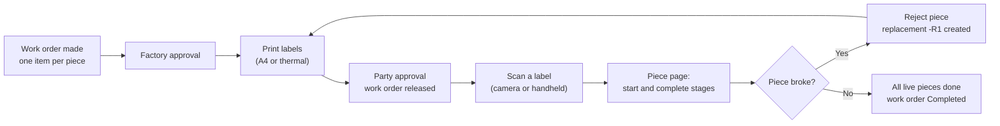

# Barcodes, Label Printing and the Production Line

Every piece of glass in a work order gets its own barcode. The factory prints those barcodes as labels, sticks one on each piece, and operators scan a label to open that piece and move it through its production stages (cutting, grinding, holes, tempering and so on). A piece that breaks is rejected and a replacement piece with a new barcode is created automatically.

**Status (checked against the `dev` branch of both repos on 2026-10-07):** built and merged. Per-piece work order items, label printing (A4 and thermal), handheld scanner and camera scanning, piece rejection with automatic replacement, and the Production Line list all work. Some parts were changed after the original plan (the piece page moved under Work Orders, and starting a stage no longer needs a second scan). One newer camera change is still only on the `feat/barcode` branch. Details are in the developer guide, section 8.

## Which file to read

| File | Who it is for | What it covers |
|---|---|---|
| [BARCODE_SCANNER_INFO.md](BARCODE_SCANNER_INFO.md) | Factory managers, office staff, operators | What the feature does, the step-by-step flow on the floor, what is printed on a label, and common questions. |
| [BARCODE_SCANNER_DEVELOPER_GUIDE.md](BARCODE_SCANNER_DEVELOPER_GUIDE.md) | Developers and AI agents | Database columns, barcode format, rules the server enforces, routes, screens and files, differences from the original plan, open questions, and how to test. |

## The flow in one picture

## Source material

The original plan is `toughened-glass/barcode-scanner-plans/Plan.md` (kept outside dev-docs). The folder `toughened-glass/barcode-scanner-plans/Image Samples/` holds photos of real supplier labels (Saint-Gobain glass sheet labels with Code 128 barcodes and a QR code) used to test that the camera reader can read real factory labels. They were not copied into dev-docs.
